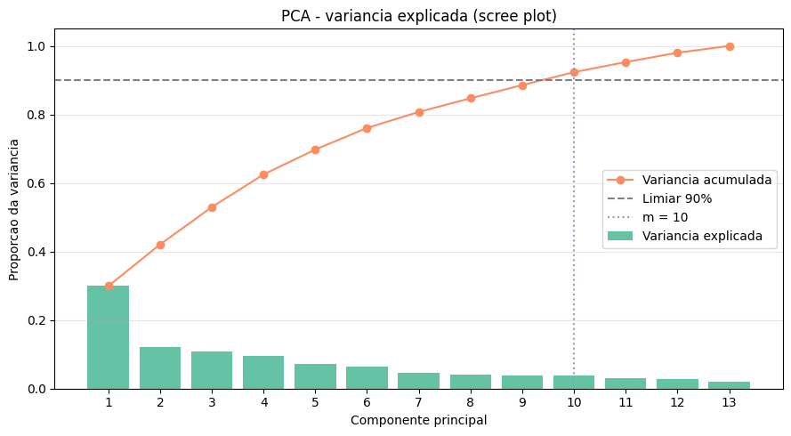
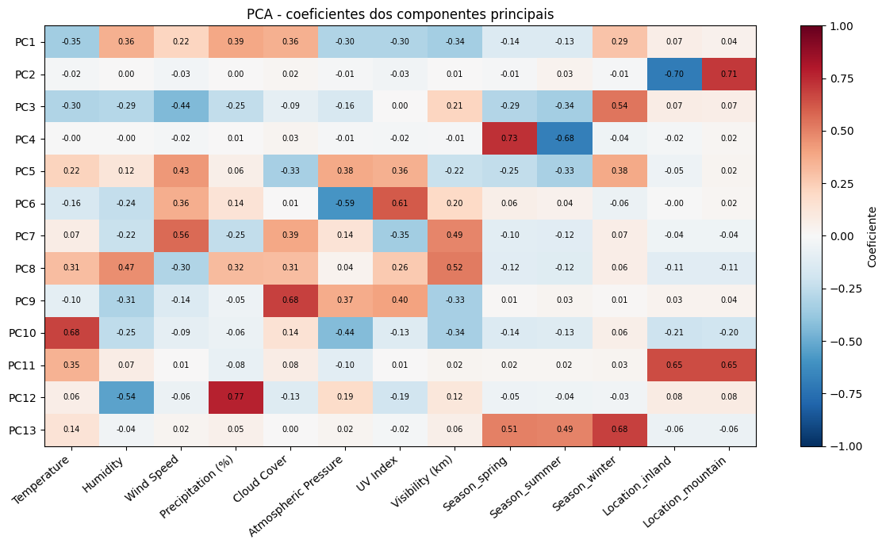
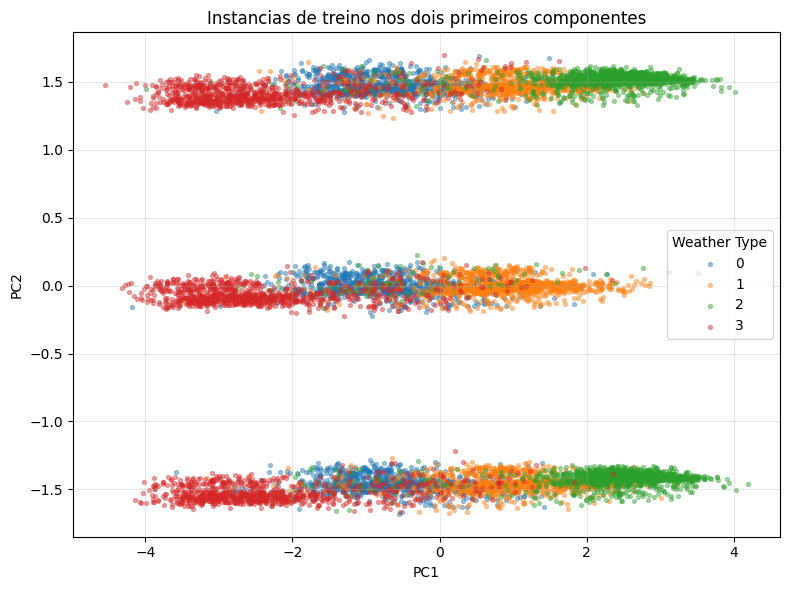
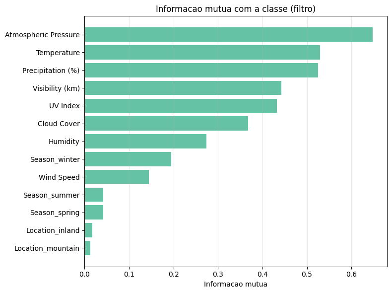

# Relatorio de reducao de dimensionalidade

Gerado automaticamente por `dimensionality_reduction.py` a partir dos dados de
`preprocessed/train_preprocessed.csv` (ja padronizados com z-score, por isso o PCA equivale a usar a
matriz de correlacao). PCA e selecao sao ajustados somente no treino.

## PCA

Variancia explicada por componente:

| Componente | Autovalor | Variancia_explicada | Variancia_acumulada |
|---|---|---|---|
| PC1 | 3.8929 | 0.2994 | 0.2994 |
| PC2 | 1.5767 | 0.1213 | 0.4207 |
| PC3 | 1.4165 | 0.109 | 0.5297 |
| PC4 | 1.239 | 0.0953 | 0.625 |
| PC5 | 0.9437 | 0.0726 | 0.6975 |
| PC6 | 0.8209 | 0.0631 | 0.7607 |
| PC7 | 0.6064 | 0.0466 | 0.8073 |
| PC8 | 0.5205 | 0.04 | 0.8473 |
| PC9 | 0.4979 | 0.0383 | 0.8856 |
| PC10 | 0.4923 | 0.0379 | 0.9235 |
| PC11 | 0.3815 | 0.0293 | 0.9529 |
| PC12 | 0.3547 | 0.0273 | 0.9801 |
| PC13 | 0.2583 | 0.0199 | 1.0 |

- Escolha: m = 10 componentes, o menor numero cuja variancia acumulada
  atinge o limiar de 90% (92.35%).
- Reducao: 13 -> 10 dimensoes.
- Caracteristicas com maior peso (|coeficiente|) em cada componente escolhido:
  - PC1: Precipitation (%), Humidity, Cloud Cover
  - PC2: Location_mountain, Location_inland, UV Index
  - PC3: Season_winter, Wind Speed, Season_summer
  - PC4: Season_spring, Season_summer, Season_winter
  - PC5: Wind Speed, Atmospheric Pressure, Season_winter
  - PC6: UV Index, Atmospheric Pressure, Wind Speed
  - PC7: Wind Speed, Visibility (km), Cloud Cover
  - PC8: Visibility (km), Humidity, Precipitation (%)
  - PC9: Cloud Cover, UV Index, Atmospheric Pressure
  - PC10: Temperature, Atmospheric Pressure, Visibility (km)

Coeficientes (autovetores) dos componentes:

| Componente | Temperature | Humidity | Wind Speed | Precipitation (%) | Cloud Cover | Atmospheric Pressure | UV Index | Visibility (km) | Season_spring | Season_summer | Season_winter | Location_inland | Location_mountain |
|---|---|---|---|---|---|---|---|---|---|---|---|---|---|
| PC1 | -0.347 | 0.358 | 0.218 | 0.39 | 0.355 | -0.301 | -0.304 | -0.343 | -0.136 | -0.133 | 0.289 | 0.067 | 0.043 |
| PC2 | -0.023 | 0.001 | -0.025 | 0.003 | 0.019 | -0.014 | -0.034 | 0.006 | -0.012 | 0.034 | -0.012 | -0.702 | 0.709 |
| PC3 | -0.299 | -0.285 | -0.441 | -0.245 | -0.089 | -0.161 | 0.004 | 0.212 | -0.293 | -0.336 | 0.537 | 0.072 | 0.065 |
| PC4 | -0.005 | -0.004 | -0.02 | 0.008 | 0.026 | -0.011 | -0.021 | -0.009 | 0.728 | -0.683 | -0.043 | -0.021 | 0.02 |
| PC5 | 0.225 | 0.121 | 0.433 | 0.057 | -0.333 | 0.38 | 0.356 | -0.219 | -0.248 | -0.327 | 0.377 | -0.051 | 0.025 |
| PC6 | -0.161 | -0.239 | 0.362 | 0.14 | 0.007 | -0.587 | 0.611 | 0.197 | 0.055 | 0.045 | -0.057 | -0.002 | 0.019 |
| PC7 | 0.075 | -0.224 | 0.563 | -0.25 | 0.389 | 0.136 | -0.35 | 0.489 | -0.105 | -0.117 | 0.067 | -0.044 | -0.044 |
| PC8 | 0.307 | 0.468 | -0.299 | 0.319 | 0.312 | 0.038 | 0.262 | 0.521 | -0.115 | -0.122 | 0.065 | -0.113 | -0.109 |
| PC9 | -0.099 | -0.305 | -0.14 | -0.048 | 0.68 | 0.371 | 0.402 | -0.333 | 0.009 | 0.028 | 0.012 | 0.033 | 0.036 |
| PC10 | 0.679 | -0.251 | -0.092 | -0.06 | 0.141 | -0.437 | -0.131 | -0.335 | -0.139 | -0.131 | 0.062 | -0.21 | -0.199 |
| PC11 | 0.348 | 0.072 | 0.007 | -0.078 | 0.077 | -0.104 | 0.005 | 0.024 | 0.018 | 0.016 | 0.027 | 0.651 | 0.652 |
| PC12 | 0.064 | -0.536 | -0.059 | 0.766 | -0.127 | 0.186 | -0.189 | 0.117 | -0.05 | -0.042 | -0.032 | 0.085 | 0.079 |
| PC13 | 0.136 | -0.036 | 0.025 | 0.049 | 0.005 | 0.024 | -0.017 | 0.059 | 0.505 | 0.494 | 0.683 | -0.059 | -0.058 |

## Selecao de caracteristicas

### Filtro: informacao mutua

Mede a dependencia entre cada caracteristica e a classe (independe do classificador).

| Caracteristica | Informacao_mutua |
|---|---|
| Atmospheric Pressure | 0.6478 |
| Temperature | 0.5294 |
| Precipitation (%) | 0.5256 |
| Visibility (km) | 0.4428 |
| UV Index | 0.432 |
| Cloud Cover | 0.3678 |
| Humidity | 0.2741 |
| Season_winter | 0.1949 |
| Wind Speed | 0.1442 |
| Season_summer | 0.0422 |
| Season_spring | 0.0419 |
| Location_inland | 0.0172 |
| Location_mountain | 0.0127 |

### Wrapper: Sequential Forward Selection

- Algoritmo: `SequentialFeatureSelector(direction="forward")` com KNN (k=5).
- Funcao de avaliacao: acuracia media em validacao cruzada estratificada de 5 folds.
- Criterio de parada: `n_features_to_select="auto"` com `tol=0.002` (para quando adicionar uma caracteristica
  melhora a acuracia em menos de 0.2 ponto percentual).
- KNN foi escolhido por ser sensivel a caracteristicas irrelevantes (usa distancia),
  o que torna a selecao mais util do que com um modelo de arvore.
- Caracteristicas selecionadas (6 de 13): ['Temperature', 'Precipitation (%)', 'Cloud Cover', 'Atmospheric Pressure', 'UV Index', 'Visibility (km)']

## Comparacao (KNN, validacao cruzada de 5 folds no treino)

| Conjunto | Acuracia_media_CV | Desvio_CV |
|---|---|---|
| Todas as caracteristicas (13) | 0.8868 | 0.0072 |
| PCA (10 componentes) | 0.8876 | 0.0061 |
| Selecao SFS (6 caracteristicas) | 0.9044 | 0.0069 |

O conjunto de teste nao foi usado em nenhuma decisao; ele foi apenas transformado
(PCA/selecao) e salvo para a etapa de modelagem.
