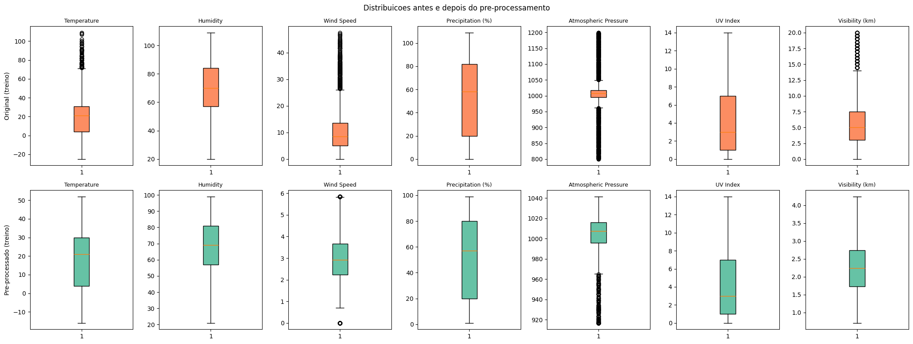
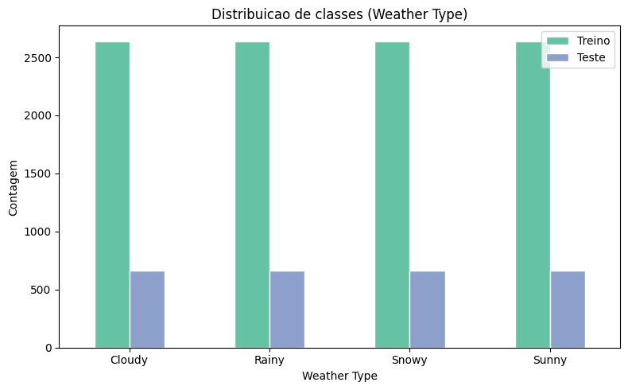

# Relatorio de pre-processamento

Gerado automaticamente por `preprocess.py`.

## Dataset original

- Instancias: 13200
- Atributos (sem a classe): 10
- Valores ausentes: 0
- Distribuicao de classes: Cloudy: 3300 (25.0%), Rainy: 3300 (25.0%), Snowy: 3300 (25.0%), Sunny: 3300 (25.0%)

## 1. Split treino / teste

- Split estratificado 80/20 (random_state=42)
- Treino: 10560 instancias | Teste: 2640 instancias

## 2. Anonimizacao

- O dataset contem apenas medicoes meteorologicas e categorias genericas de local
  (inland/coastal/mountain); nao ha identificadores diretos, quasi-identificadores
  nem atributos sensiveis de pessoas. Nenhuma supressao/tokenizacao foi necessaria.

## 3. Limpeza

- Strings categoricas padronizadas (strip + minusculas).
- Duplicatas exatas removidas: treino=0, teste=0
- Instancias com mesmos atributos e classes diferentes removidas: treino=0, teste=0
- Valores fisicamente impossiveis (outliers tipo 1, erro de medicao/digitacao)
  substituidos por NaN para imputacao no passo 7:
  - Temperature: treino=163, teste=44 (faixa valida (-90.0, 60.0))
  - Humidity: treino=340, teste=76 (faixa valida (0.0, 100.0))
  - Precipitation (%): treino=322, teste=70 (faixa valida (0.0, 100.0))
  - Atmospheric Pressure: treino=447, teste=117 (faixa valida (870.0, 1085.0))
- Instancias afetadas no treino: 1130 (10.70%). Como sao >5% das instancias, optou-se por imputar em vez de remover.

## 4. Tratamento de outliers

- Deteccao no treino pelos criterios do boxplot (1.5*IQR) e do z-score (|z|>3).
- Valores plausiveis, mas extremos (outliers tipo 2), foram mantidos com capping
  nos percentis 1 e 99 do treino, preservando o numero de instancias e reduzindo a influencia dos extremos.

| Caracteristica | Outliers_IQR_antes | Outliers_zscore_antes | Outliers_IQR_depois | Outliers_zscore_depois |
|---|---|---|---|---|
| Temperature | 0 | 0 | 0 | 0 |
| Humidity | 0 | 0 | 0 | 0 |
| Wind Speed | 324 | 180 | 324 | 207 |
| Precipitation (%) | 0 | 0 | 0 | 0 |
| Atmospheric Pressure | 300 | 236 | 209 | 188 |
| UV Index | 0 | 0 | 0 | 0 |
| Visibility (km) | 320 | 235 | 320 | 235 |

- Limites usados: Temperature=[-16.00, 52.00], Humidity=[21.00, 99.00], Wind Speed=[0.00, 34.20], Precipitation (%)=[1.00, 99.00], Atmospheric Pressure=[916.70, 1041.38], UV Index=[0.00, 14.00], Visibility (km)=[0.50, 18.00]

## 5. Codificacao e transformacao de distribuicao

- Cloud Cover (ordinal): ordinal encoding {0: 'clear', 1: 'partly cloudy', 2: 'cloudy', 3: 'overcast'}
- Season e Location (nominais): one-hot com k-1 colunas (drop_first) -> ['Season_spring', 'Season_summer', 'Season_winter', 'Location_inland', 'Location_mountain']
- Weather Type (classe alvo): label encoding {0: 'Cloudy', 1: 'Rainy', 2: 'Snowy', 3: 'Sunny'}
- Transformacao de distribuicao (log1p ou sqrt, a que deixar a assimetria mais proxima de 0) nas colunas com assimetria > 1.0 no treino: Wind Speed -> sqrt (skew 1.09 -> -0.06), Visibility (km) -> sqrt (skew 1.17 -> 0.24)

## 6. Engenharia de caracteristicas

- Nao aplicada nesta etapa (sera vista mais a frente na disciplina).

## 7. Imputacao de valores ausentes

- Imputacao simples pela mediana (ajustada no treino e aplicada no teste).
- Valores imputados no treino: 1272; nulos restantes: treino=0, teste=0
- Medianas usadas (na escala ja transformada do passo 5): Temperature=21.00, Humidity=69.00, Wind Speed=2.92, Precipitation (%)=57.00, Atmospheric Pressure=1007.32, UV Index=3.00, Visibility (km)=2.24

## 8. Balanceamento de classes

- Distribuicao de classes no treino: Cloudy: 2640 (25.0%), Rainy: 2640 (25.0%), Snowy: 2640 (25.0%), Sunny: 2640 (25.0%)
- Razao classe majoritaria/minoritaria: 1.00
- Classes ja balanceadas: balanceamento nao e necessario.

## 9. Normalizacao

- StandardScaler (z-score) ajustado no treino e aplicado no teste. Apos o capping os
  outliers ja tem pouca influencia, entao a padronizacao z-score e adequada e deixa
  todas as caracteristicas na mesma escala (necessario para KNN, SVM, PCA etc.).
- Media no treino ~ 6.2e-15, desvio ~ 1.000

## Resumo final

- Instancias: 13200 -> treino 10560 + teste 2640 = 13200
- Atributos: 10 -> 13 (apos one-hot)
- Atributos finais: ['Temperature', 'Humidity', 'Wind Speed', 'Precipitation (%)', 'Cloud Cover', 'Atmospheric Pressure', 'UV Index', 'Visibility (km)', 'Season_spring', 'Season_summer', 'Season_winter', 'Location_inland', 'Location_mountain']
- Valores ausentes finais: 0
- Distribuicao de classes treino: Cloudy: 2640 (25.0%), Rainy: 2640 (25.0%), Snowy: 2640 (25.0%), Sunny: 2640 (25.0%)
- Distribuicao de classes teste: Cloudy: 660 (25.0%), Rainy: 660 (25.0%), Snowy: 660 (25.0%), Sunny: 660 (25.0%)

Estatisticas descritivas (treino, sem escalonamento) antes e depois:

### Antes

| Caracteristica | mean | std | min | 50% | max | skew |
|---|---|---|---|---|---|---|
| Temperature | 19.175 | 17.413 | -25.0 | 21.0 | 109.0 | 0.221 |
| Humidity | 68.856 | 20.194 | 20.0 | 70.0 | 109.0 | -0.41 |
| Wind Speed | 9.821 | 6.895 | 0.0 | 8.5 | 47.5 | 1.334 |
| Precipitation (%) | 53.832 | 32.05 | 0.0 | 58.0 | 109.0 | -0.156 |
| Atmospheric Pressure | 1005.826 | 37.049 | 800.12 | 1007.58 | 1199.21 | -0.299 |
| UV Index | 4.003 | 3.86 | 0.0 | 3.0 | 14.0 | 0.906 |
| Visibility (km) | 5.482 | 3.395 | 0.0 | 5.0 | 20.0 | 1.25 |

### Depois (antes da normalizacao z-score)

| Caracteristica | mean | std | min | 50% | max | skew |
|---|---|---|---|---|---|---|
| Temperature | 18.351 | 15.833 | -16.0 | 21.0 | 52.0 | -0.262 |
| Humidity | 67.696 | 19.06 | 21.0 | 69.0 | 99.0 | -0.525 |
| Wind Speed | 2.92 | 1.117 | 0.0 | 2.915 | 5.849 | -0.057 |
| Precipitation (%) | 52.377 | 30.729 | 1.0 | 57.0 | 99.0 | -0.174 |
| Cloud Cover | 1.796 | 1.188 | 0.0 | 1.0 | 3.0 | -0.179 |
| Atmospheric Pressure | 1004.867 | 17.146 | 916.697 | 1007.32 | 1041.38 | -1.893 |
| UV Index | 4.003 | 3.86 | 0.0 | 3.0 | 14.0 | 0.906 |
| Visibility (km) | 2.229 | 0.709 | 0.707 | 2.236 | 4.243 | 0.239 |
| Season_spring | 0.198 | 0.398 | 0.0 | 0.0 | 1.0 | 1.518 |
| Season_summer | 0.187 | 0.39 | 0.0 | 0.0 | 1.0 | 1.605 |
| Season_winter | 0.426 | 0.494 | 0.0 | 0.0 | 1.0 | 0.301 |
| Location_inland | 0.365 | 0.481 | 0.0 | 0.0 | 1.0 | 0.562 |
| Location_mountain | 0.365 | 0.482 | 0.0 | 0.0 | 1.0 | 0.56 |

